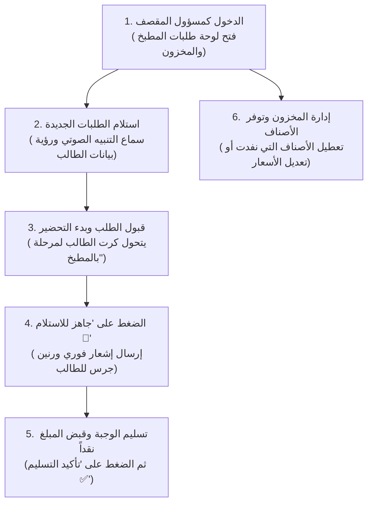

# 🥪 دليل استخدام مقصف الفُسحة المدرسية
## مشروع وفكرة الطالبة: زينة اللبدي (الصف الثامن )
### شرح مبسط وتطبيقي لكيفية استخدام الموقع لكل دور (الطالب ومسؤول المقصف) 🌟

---

## 💡 ما هو موقع «مقصف الفسحة»؟
هو موقع ويب مدرسي صممته الطالبة **المقصف الذكي** لحل مشكلة الازدحام والطوابير الطويلة أمام المقصف المدرسي أثناء الفسحة.

بدلاً من أن يقضي الطالب فسحته واقفاً في الطابور، يتيح له هذا الموقع تصفح قائمة طعام المقصف، واختيار فطوره المفضل، وإرسال طلبه مسبقاً، ثم الذهاب مباشرة لنافذة المقصف في موعد الفسحة الوحيد **(الساعة 10:00 صباحاً)** لاستلام وجبته ساخنة وجاهزة باسمه في ثوانٍ معدودة!

---

## 🎒 الدور الأول: دليل استخدام الطالب / الطالبة (كيف يطلب الطالب فطوره؟)

```
    A["1. الدخول لحساب الطالب (بنقرة واحدة أو إنشاء حساب)"] --> B["2. تصفح قائمة الطعام (وقراءة وصف الوجبة ومكوناتها)"]
    B --> C["3. إضافة الوجبات للسلة (وتسجيل أي ملاحظات خاصة)"]
    C --> D["4. تأكيد الطلب واستلام الكرت (الحصول على رقم الطلب والباركود)"]
    D --> E["5. متابعة مراحل التحضير (انتظار رنين الجرس: وجبتك جاهزة 🔔)"]
    E --> F["6. استلام الوجبة 10:00 ص (من نافذة المقصف والدفع نقداً)"]
```

### 1. الدخول إلى الموقع:
* **الدخول السريع بنقرة واحدة:**
  * يفتح الطالب الموقع ويضغط على زر الحساب 👤 أعلى الصفحة.
  * يجد قائمة "الدخول السريع"، فيضغط على زر **«دخول ⚡»** بجانب اسمه (مثل حساب **زينة اللبدي**) ويدخل فوراً دون الحاجة لكتابة أي كلمة مرور.
* **إذا كان طالباً جديداً:**
  * يضغط على تبويب **«حساب طالب جديد ✨»**.
  * يكتب اسمه، ويختار صفه (مثلاً: الصف الثامن)، وشعبته (أ، ب، ج، د)، ويكتب كلمة مرور بسيطة (مثل `123`).
  * يضع إشارة صح على "حفظ في الدخول السريع" ليتمكن من الدخول بنقرة زر في المرات القادمة.

---

### 2. اختيار وجبة الفطور المفضلة:
* في أعلى الصفحة، يشاهد الطالب **ساعة العد التنازلي (⏳)** التي تحسب الوقت المتبقي على جرس فسحة العاشرة صباحاً (10:00 ص).
* يتصفح الطالب أقسام المقصف الستة:
  1. 🥪 **الساندويشات والبيتزا:** بيتزا ببروني، بيتزا خضار، بيتزا باربكيو، ساندويش لبنة وتيركي، جبنة، خضار...
  2. 🥗 **السلطات والمقبلات:** سلطة سيزر، سلطة عربية، يلنجي ورق عنب، سوشي...
  3. 🍝 **الباستا والأطباق الساخنة:** فوتتشيني، معكرونة بالصلصة الحمراء، ماك أند تشيز، بطاطا مهروسة.
  4. 🧃 **العصائر والمشروبات:** حليب فراولة، حليب موز، عصير برتقال، تفاح، فواكه، شنينه أصلية، شنينه فراولة، وماء.
  5. 🍛 **الأطباق الرئيسية:** طبق اليوم من الأرز الساخن.
  6. 🧁 **الحلويات والتسالي:** براوني، كوكيز، ليزي كيك، كب كيك، كورن فليكس بار.
* **قراءة وصف الوجبة:** كل صنف يحتوي على صندوق مميز يشرح شكل الوجبة ومكوناتها وسعراتها ليختار الطالب ما يحبه بدقة.
* يضغط الطالب زر **«أضف لفطور الفسحة (10:00 ص)»** ويمكنه تعديل الكمية (مثلاً: 2 عصير و 1 ساندويش).

---

### 3. تأكيد الطلب وكتابة الملاحظات:
* يفتح الطالب السلة 🛒 لمراجعة وجباته ومجموع السعر.
* يتأكد من اسمه وصفه وشعبته المكتوبة تلقائياً.
* **خانة الملاحظات:** يمكن للطالب كتابة أي رغبة خاصة لمسؤول المقصف (مثل: "بدون بصل"، "تسخين إضافي"، أو تنبيه بوجود حساسية من طعام معين).
* يضغط الزر الأخضر: **«تأكيد الطلب واستلام كرت الفسحة 🎫»**، ويظهر له احتفال القصاصات الملونة (الكونفيتي).

---

### 4. كرت الاستلام الرقمي (متابعة الطلب واستلام الوجبة):
* فور التأكيد، يظهر للطالب **كرت استلام وجبة الفسحة**، ويحتوي على:
  * رقم الطلب (مثل: `#ORD-245`).
  * اسم الطالب والصف والشعبة.
  * موعد الاستلام: **الفسحة المدرسية (10:00 صباحاً)**.
  * نافذة الاستلام المخصصة للصف الثامن.
* **متابعة مراحل تحضير الوجبة (4 مراحل حية):**
  1. `تم الطلب ⏳`: الطلب مسجل وبانتظار موافقة مسؤول المقصف.
  2. `بالمطبخ 👨‍🍳`: الوجبة يتم تجهيزها وتسخينها لك الآن في المطبخ!
  3. `جاهز للاستلام 🔔`: رنين جرس وتنبيه صوتي ولافتة خضراء تخبرك بأن وجبتك جاهزة وساخنة على نافذة المقصف!
  4. `تم الاستلام ✅`: تم تسليمك الوجبة بنجاح.
* **طريقة الاستلام:** عند رنين جرس الفسحة الساعة 10:00 صباحاً، يتوجه الطالب لنافذة المقصف، يظهر رقمه أو كرته للمسؤول، يستلم وجبته ساخنة فوراً، ويدفع المبلغ نقداً.
* **إعادة فتح الكرت أو طباعته:** يمكن للطالب فتح كرته في أي لحظة بالضغط على زر **«كرت استلامي 🎫»** أعلى الموقع (أو زر "كرتي" أسفل شاشة الهاتف)، كما يمكنه طباعة نسخة ورقية بضغطة زر.

---

## 👨‍🍳 الدور الثاني: دليل استخدام مسؤول / صاحب المقصف (كيف يدير المقصف والطلبات؟)



### 1. الدخول إلى شاشة المقصف:
* يضغط صاحب المقصف على زر الحساب 👤 ويختار **«إدارة المقصف (المسؤول)»** من الدخول السريع.
* يظهر له زر ذهبي مميز أعلى الموقع: **«لوحة طلبات المطبخ»**.

---

### 2. متابعة الإحصائيات الفورية للفسحة:
تظهر في أعلى الشاشة 5 بطاقات رقمية واضحة ومباشرة:
1. **إجمالي طلبات الفسحة:** العدد الكلي للطلاب الذين طلبوا اليوم.
2. **بانتظار الموافقة:** الطلبات الجديدة التي تحتاج لبدء تجهيزها.
3. **قيد التحضير بالمطبخ:** الوجبات التي يتم إعدادها وتسخينها حالياً.
4. **جاهزة للاستلام:** الوجبات المنتهية والموجودة على نافذة التسليم.
5. **المبيعات الإجمالية:** مجموع المبالغ النقدية الواجب تحصيلها بالدينار الأردني.

---

### 3. التعامل مع طلبات الطلاب خطوة بخطوة:
* كل طلب يظهر في بطاقة واضحة تحتوي على: (رقم الطلب، اسم الطالب، صفه وشعبته، موعد الفسحة 10:00 ص، قائمة الوجبات المطلوبة، وأي ملاحظات خاصة بالطالب كالحساسية).
* عند وصول أي طلب جديد، يصدر الموقع **تنبيهاً صوتياً مميزاً**.
* **الخطوة الأولى (الموافقة):** يضغط المسؤول زر **«قبول وبدء التحضير للفسحة»**، فيتغير لون الطلب ويعرف الطالب أن وجبته بدأ تحضيرها.
* **الخطوة الثانية (إشعار الجاهزية):** بعد تجهيز الساندويش والعصير ووضعهما على النافذة، يضغط المسؤول زر **«إشعار الطالب: الطلب جاهز على النافذة 🔔»**. في هذه اللحظة، يرن جرس التنبيه لدى الطالب وتظهر له رسالة خضراء تطلب منه التوجه للمقصف للاستلام.
* **الخطوة الثالثة (التسليم):** عندما يحضر الطالب ويظهر رقم طلبه، يسلمه المسؤول الوجبة ويستلم المبلغ نقداً، ثم يضغط زر **«تأكيد التسليم ✅»** ليتم حفظ الطلب كمكتمل.

---

### 4. التحكم في توفر الأصناف والمخزون المدرسي (بكل بساطة):
من تبويب **«إدارة وتعديل مخزون المقصف وتوفر الأصناف»**:
* **إذا نفد أي صنف في المقصف:**
  * يجد المسؤول جميع الأصناف الـ 29 أمامه مع صورها وأسعارها.
  * بجانب كل وجبة يوجد زر أخضر كبير: **«متوفر (انقر للتعطيل)»**.
  * بمجرد الضغط عليه، يتحول الزر إلى اللون الأحمر: **«❌ نفد مؤقتاً»**، ويصبح الصنف مخفياً أو غير قابل للطلب لدى الطلاب لحين إعادة تزويده، مما يمنع إحراج نفاد الوجبات!
* **تعديل سعر أو تفاصيل وجبة:**
  * يضغط المسؤول على أيقونة القلم ✏️ لتعديل السعر أو وقت التحضير أو المكونات ثم يضغط حفظ.
* **إضافة صنف جديد:**
  * يضغط زر **«إضافة صنف جديد للمقصف»**، ويكتب اسمه وقسمه وسعره، فيظهر فوراً للطلاب في القائمة.
* **استعادة القائمة الأصلية:**
  * إذا رغب في إعادة ضبط القائمة على الأصناف الـ 29 الأصلية، يضغط زر **«استعادة الأصناف الأصلية»**.

---

## ☀️ ملخص نهائي لطريقة سير العمل في دقيقة واحدة:
1. **الطالب:** يختار فطوره من هاتفه أو حاسوبه ⬅️ يرسل طلبه ⬅️ يحصل على كرت الفسحة الرقمي.
2. **مسؤول المقصف:** يرى الطلب في شاشة المطبخ ⬅️ يجهزه ⬅️ يضغط زر "جاهز 🔔".
3. **وقت الفسحة (10:00 صباحاً):** يخرج الطالب من فصله ⬅️ يتوجه لنافذة المقصف ⬅️ يستلم وجبته الساخنة فوراً ويدفع نقداً دون أي انتظار في الطابور!

**مقصف الفسحة المدرسي الذكي • إعداد وتصميم الطالبة زينة اللبدي ✨**
